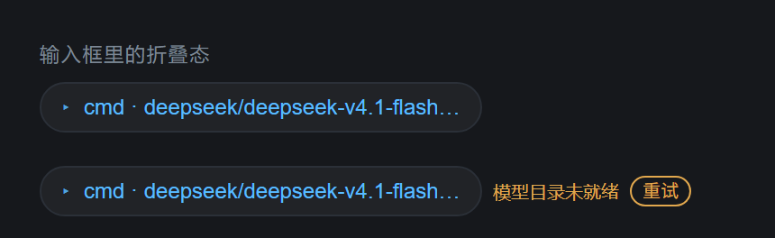
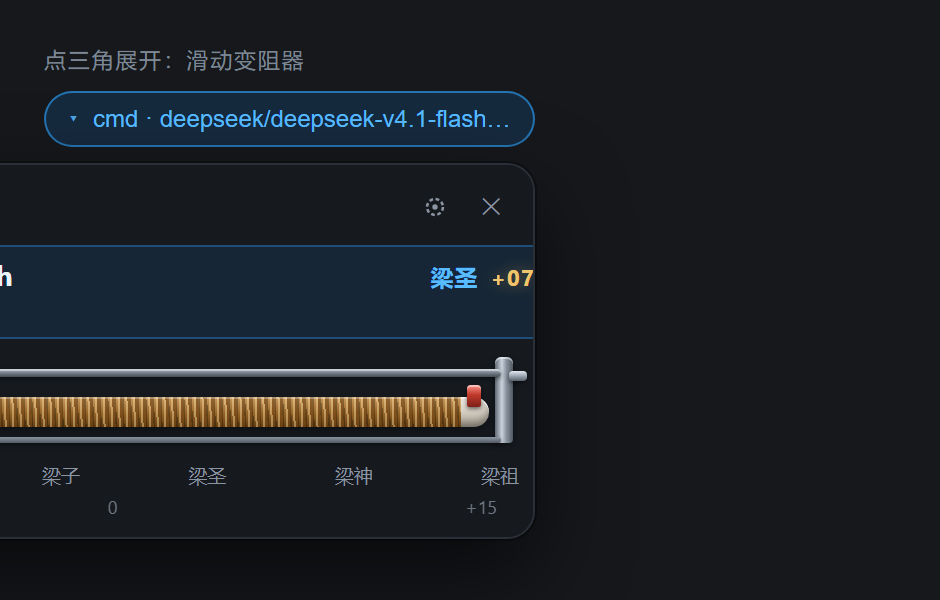
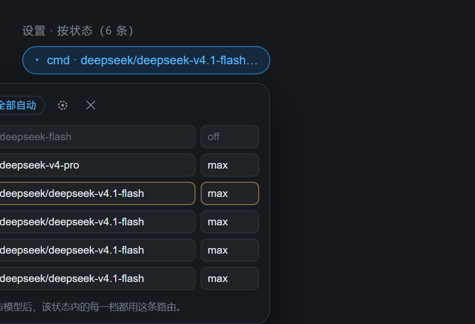
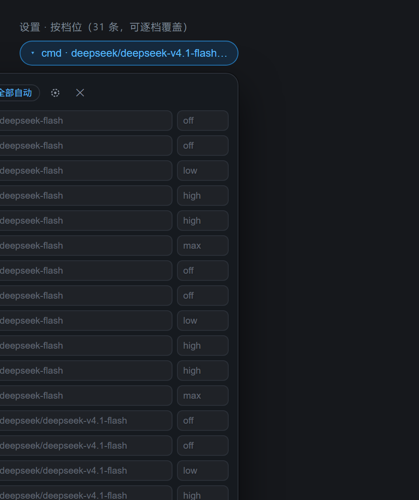
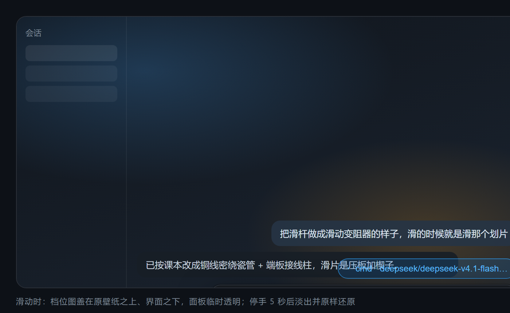

# dsh-liang-calibrator

**滑动变祖器 31 档** —— 把 [DeepSeek Harness](https://github.com/deepseek-ai) 输入框里的「模型选择 + 推理等级」控件，换成一台物理课本里的**滑动变阻器**。

拖滑片 = 同时切换模型与思考强度；滑动时对应的档位形象图会铺在 DSH 背景上，**停手 5 秒后自动淡出**。

[](https://github.com/TerryYu12/dsh-liang-calibrator/actions/workflows/ci.yml)



---

## 界面

### 1. 折叠态：直接写清当前路由

输入框里只占一个小胶囊，显示 **提供商 · 模型 · 思考强度**（过长省略，悬停看完整内容）。
模型目录还没就绪、或会话被锁定时，旁边会直接说明原因并给出「重试」。

### 2. 点三角展开：滑动变阻器

铜线密绕瓷管 + 金属导轨 + 端板接线柱（C/D）+ 瓷管两端红色接线柱（A/B）+ 压板楔子滑片，
左侧到滑片的那段铜线微微发亮表示"接入电路"的长度。



第一行是**模型名**（最大最亮），右侧是「梁名 + 带符号分值」，第二行是 `提供商 · 思考强度`。
点面板外、按 `Esc`、或点右上角 `✕` 都能收起。

### 3. 设置：按状态 6 / 按档位 31





- **按状态 6**：小难梁 / 牢梁 / 梁子 / 梁圣 / 梁神 / 梁祖，各一条路由，整段生效；
- **按档位 31**：`-15` … `00` … `+15` 逐档一行，只覆盖你想改的那一档；
- 三列**都能手填**（provider / 模型 id / 思考强度），带自动补全但允许任意值 —— 接自己的 API 直接写进去即可；
- 灰色占位符显示**自动分档会选什么**，所以不改也能一眼看出每档接的是哪条路由；
- 优先级：**逐档 > 按状态 > 自动**；provider 不在当前目录时整行描琥珀色提示（仍会提交，由平台裁决）；
- 「全部自动」一键清空，设置只存在本机浏览器（`localStorage`）。

### 4. 滑动时的背景：不影响你原来的壁纸



档位图只做**临时叠加**：

- 它挂在 `body` 的第一个子节点、`z-index: -1`，位置在**你原来的壁纸之上、DSH 界面之下**；
- 显示期间把控件到 `body` 之间的面板**临时置为透明**，配合图层自带的压暗层保证文字可读；
- **停手 5 秒后自动淡出**（淡出 320ms），随后**原样还原**所有被改过的样式；
- 不修改、不替换你设置的壁纸，也不写入任何持久状态 —— 关掉插件后界面与原来完全一致。

---

## 档位语义

31 档由 `buildLadder()` **按当前模型目录动态生成**：

1. **模型分档**：按 `MODEL_TIERS` 顺序（由弱到强）把六个状态带平均切给目录里**实际存在**的模型。
   某个 provider 没配置或掉线时它的段会被跳过，帧区间自动重新平均给剩下的模型 —— 梯子只会变短，
   滑杆不会失效。改顺序或增删模型只改 `MODEL_TIERS` 一个数组。
2. **思考强度**：每个模型覆盖的那段帧，按该模型在目录里公布的等级**均分**，从弱到强单调递增；
   模型明确不提供等级时（例如 `dsh-llm-pi-ai` 对没声明 `reasoningEfforts` 的模型返回 `reasoning: false`），
   这一段只提交模型本身，**不带 `reasoningEffort`**。

本机 DSH `0.2.0-rc.2`、三个模型都在时（flash / pro 各有 `off/low/high/max`，cmd 不分等级）：

| 帧 index | 分值 | 状态 | 模型 | 思考强度 |
|---|---|---|---|---|
| 0-4 | -15..-11 | 小难梁 | deepseek-flash | off |
| 5-8 | -10..-7 | 小难梁/牢梁 | deepseek-flash | low |
| 9-13 | -6..-2 | 牢梁/梁子 | deepseek-flash | high |
| 14-17 | -1..+2 | 梁子 | deepseek-flash | max |
| 18-23 | +3..+8 | 梁圣 | `deepseek/deepseek-v4.1-flash`（cmd） | 不设置 |
| 24-25 | +9..+10 | 梁神 | deepseek-v4-pro | off |
| 26-27 | +11..+12 | 梁神 | deepseek-v4-pro | low |
| 28-29 | +13..+14 | 梁神 | deepseek-v4-pro | high |
| 30 | +15 | 梁祖 | deepseek-v4-pro | max |

同一组合占据连续若干档：**区间内拖动只换画面、不重复发请求**；外部改变模型（`/model` 命令、设置页）时，
滑杆会回位到对应区间的代表档位。当前选择不在梯子上时，芯片回退显示真实路由，滑杆仍可跳到任意档位。

---

## 安装

```sh
# 从 Release 安装
dsh plugin --profile <profile> add https://github.com/TerryYu12/dsh-liang-calibrator/releases/latest/download/dsh-liang-calibrator-0.8.0.tgz

# 或本地 tarball
dsh plugin --profile <profile> add /path/to/dsh-liang-calibrator-0.8.0.tgz
```

`<profile>` 是你要装的 profile（通常是 `desktop`；用 `dsh plugin --profile desktop add …`）。
装好后 DSH 会把这个 bundle 追加进 profile 的 `dsh.profile.bundles`，客户端半部由 `dsh-client-modules`
作为 `/plugins/dsh-liang-calibrator/client.js` 提供。多数情况下无需重启即会热挂载；
若界面没变化，刷新页面或重启 Harness。

卸载：

```sh
dsh plugin --profile <profile> remove dsh-liang-calibrator
```

---

## 从源码构建 / 测试 / 截图

```sh
npm install
node scripts/fetch-frames.mjs   # 可选：素材缺失时从上游补抓（仓库里已带）
npm run build                   # 生成 lib/index.js 与 lib/client.js（内嵌 31 帧，约 2 MB）
node verify-levels.mjs          # 31 档 / 6 状态边界与梯子生成
node render-test.mjs            # jsdom + React 真渲染：17 个场景
node tools/screenshot.mjs       # 重新生成 docs/ 里的界面截图（需要本机 Chrome/Edge）
npm pack
```

`render-test.mjs` 覆盖的 17 个场景包括：档位提交、段内不重复提交、目录未就绪与自愈重试、
锁定态、错误边界、背景图 5 秒淡出、注入面绝不抛错、折叠/展开/关闭、以及按状态与按档位两层设置。

> 实现上有三条**不能破坏**的约束，改动前请先读 README 的对应注释：
> ① 客户端 `inject` 必须包含 `remote` / `remote.session`（Cordis 服务代理把 `this.ctx` 绑到调用方，
> `directoryFor()` 内部会读它，漏了目录永远取不到）；② 目录加载不能依赖注入函数的引用（否则渲染循环）；
> ③ 插槽注入面绝不能抛异常（会被渲染器把整个入口退役，界面静默退回官方控件）。

---

## 素材与授权

本插件是对 [Lichtspektrum/liang-intensity-calibrator](https://github.com/Lichtspektrum/liang-intensity-calibrator)
（滑动变祖器）的 DSH 化改造；控件结构参考了 [HansLin911/dsh-liang-slider](https://github.com/HansLin911/dsh-liang-slider)（MIT-0）。

`assets/frame-00..30.webp` 取自上游仓库的 `public/frames/`。依照上游仓库的处理方式，这些素材**随仓库分发**，
但——正如上游 README 所述——**素材不随 MIT 协议共享**：

> `media` 与 `public/frames` 里的人像素材用于趣味演示，**素材不随 MIT 协议共享**。
> 复用或二次发布前，请确认你拥有相关肖像与素材的使用权。

本项目维护者不拥有这些图像中人物的肖像权，也不通过本项目授予任何与肖像、姓名、身份、公开权、隐私权、
商标、版权或其他第三方权利有关的许可。若需商业使用、再分发或制作衍生版本，请自行确认所在司法管辖区的
适用法律、素材来源及所需授权。如你是相关权利人并希望移除素材，请提 Issue 联系。

## 许可证

**代码**以 [MIT-0](LICENSE) 发布（不含 `assets/` 中的第三方图像素材，见上节）。
